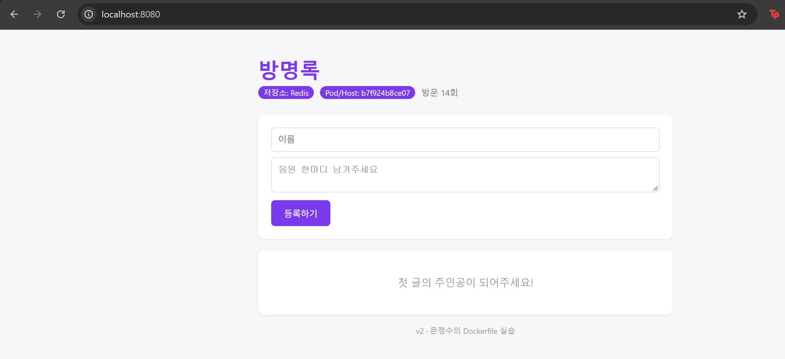
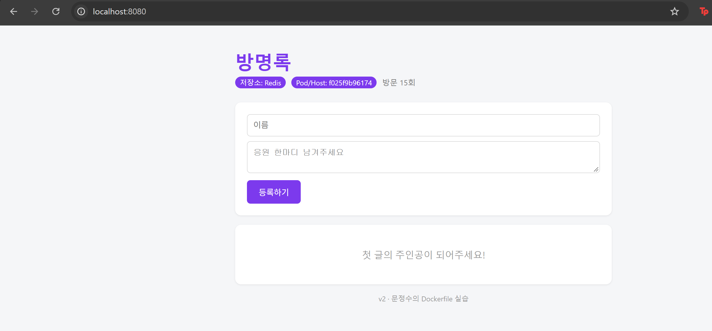
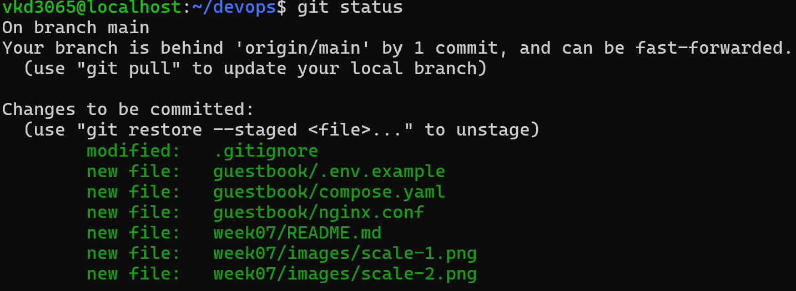

# 7주차 - 도커 컴포즈

지난주에 "이미지를 공유해도 방명록 글은 같이 안 넘어간다"고 썼는데,
이번 주에 그 문제를 해결했다. 앱이랑 Redis를 컨테이너로 나누고,
compose.yaml 파일 하나로 같이 띄웠다. 이제 web을 재시작해도 글이 안 사라진다.

최종 구조: 브라우저 → nginx(8080) → web 3개 → redis 1개 (+볼륨)

## docker compose ps (healthy 포함)

nginx + web 3개 + redis까지 다 띄운 최종 상태에서 찍었다.
(restart나 scale 직후에 찍으면 `health: starting`으로 나와서 조금 기다렸다가 찍음)

```
NAME                IMAGE            COMMAND                  SERVICE   CREATED          STATUS                    PORTS
guestbook-nginx-1   nginx:alpine     "/docker-entrypoint.…"   nginx     23 minutes ago   Up 23 minutes             0.0.0.0:8080->80/tcp, [::]:8080->80/tcp
guestbook-redis-1   redis:7-alpine   "docker-entrypoint.s…"   redis     50 minutes ago   Up 50 minutes (healthy)   6379/tcp
guestbook-web-1     guestbook-web    "python app.py"          web       11 minutes ago   Up 11 minutes (healthy)   0.0.0.0:53840->5000/tcp, [::]:53840->5000/tcp
guestbook-web-2     guestbook-web    "python app.py"          web       11 minutes ago   Up 11 minutes (healthy)   0.0.0.0:53841->5000/tcp, [::]:53841->5000/tcp
guestbook-web-3     guestbook-web    "python app.py"          web       11 minutes ago   Up 11 minutes (healthy)   0.0.0.0:53844->5000/tcp, [::]:53844->5000/tcp
```

## scale 후 Pod/Host가 바뀌는 것

`docker compose up -d --scale web=3`으로 web을 3개 띄우고 새로고침을 반복했다.
새로고침할 때마다 화면의 Pod/Host 값이 바뀌었고, `docker ps`의 컨테이너 ID랑 일치했다.
nginx가 요청을 돌아가면서 나눠주는 거였다 (로드 밸런싱).




글은 어느 web이 응답해도 똑같았다. 데이터가 redis 한 곳에 있어서 그렇다.

## down 후 up vs down -v 후 up

| 명령 | 지워지는 것 | 다시 up 하면 글은? |
|---|---|---|
| down | 컨테이너, 네트워크 | 남아있음 (볼륨이 살아있어서) |
| down -v | 컨테이너, 네트워크 + 볼륨 | 사라짐 |

직접 해 봤는데 down 후 up은 글이 그대로였고, down -v 후 up은 진짜 다 날아갔다.
컨테이너는 일회용이고 데이터는 볼륨에 있다는 게 이해됐다.
운영에서 -v 잘못 치면 큰일 나겠다 싶었다.

## .env를 Git에 올리지 않는 이유

- compose.yaml에 비밀번호를 그대로 쓰면 GitHub에 올리는 순간 전 세계 공개다.
- 나중에 파일에서 지워도 Git 이력(과거 커밋)에는 그대로 남는다.
- 그래서 값은 .env에 빼고, compose.yaml에는 `${REDIS_PASSWORD:?비밀번호 설정 필요}`만 적었다.
  값이 비어 있으면 에러 내고 멈추는 것도 확인했다.
- .env는 .gitignore로 제외하고, 대신 .env.example로 "이런 변수가 필요하다"는 양식만 올렸다.
- .gitignore는 숨기는 거지 암호화가 아니라서, 어쨌든 올라가면 끝이다.
- .dockerignore에도 .env가 있어서 이미지 안에도 안 들어간다.

제출 전에 `git status`로 compose.yaml / nginx.conf / .env.example은 있고
.env는 없는 것 확인했다.

```

```