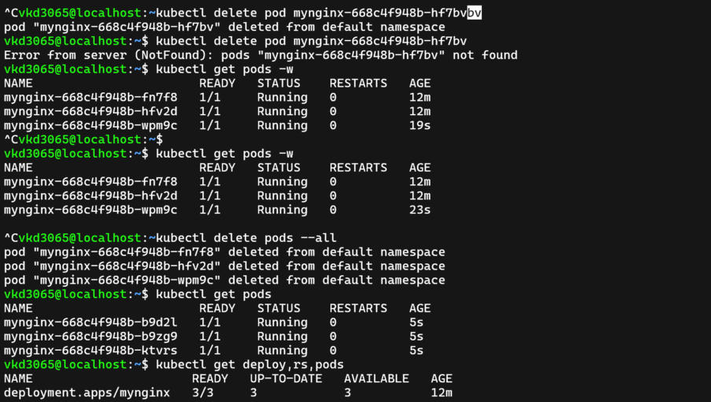
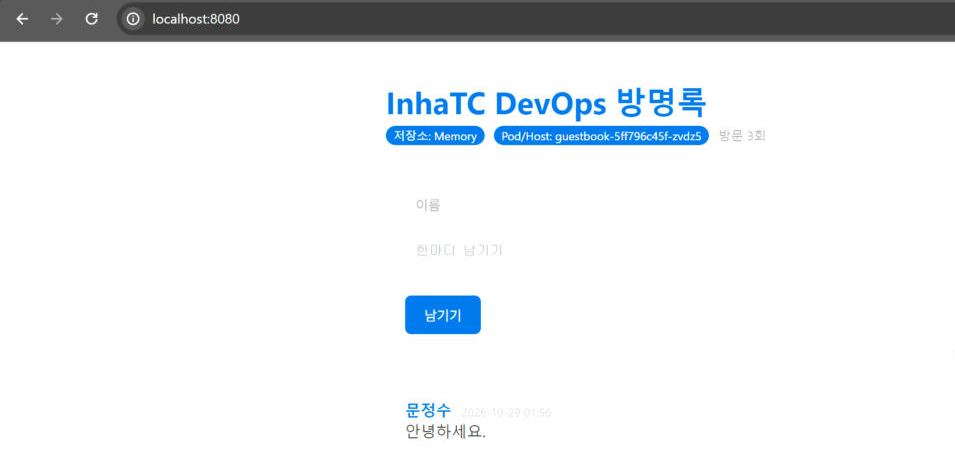

# 9주차 - 쿠버네티스

사용한 도구: minikube

## 1. kubectl get nodes

```
NAME       STATUS   ROLES           AGE     VERSION
minikube   Ready    control-plane   4m56s   v1.37.0
```

## 2. Pod를 지운 뒤 새 Pod가 태어난 화면



guestbook-5ff796c45f-qk9kf를 지웠더니, Deployment가 새 Pod guestbook-5ff796c45f-zvdz5를 만들었다 (Pending → ContainerCreating → Running).

## 3. 쿠버네티스에서 뜬 내 방명록



Pod/Host에 Pod 이름(guestbook-5ff796c45f-zvdz5)이 나온다. Redis 없이 띄워서 저장소는 Memory.

## 4. 선언형을 내 말로

선언형은 "어떻게 하라"가 아니라 "이 상태여야 한다"만 정해 두면, 쿠버네티스가 계속 확인하면서 그 상태로 맞춰 주는
방식이다.
예시: 보일러를 22도로 맞춰 두면, 방이 식을 때마다 내가 켜지 않아도 알아서 다시 22도로 데운다.

## 5. 막혔던 것과 해결

- 브라우저에 nginx 화면이 계속 나옴 → port-forward를 다시 켜고 새로고침하니 방명록이 나옴
